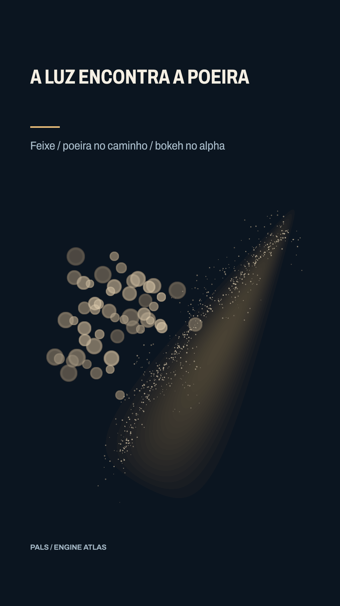

# A luz encontra a poeira



[Clipe de 3.5 s](clip.mp4)

Um caminho emite poeira; a silhueta opaca de um asset emite bokeh. Ambos usam seeds fixos. Vitrine revisada: Archivo, subtítulo36 e assunto próprio. Vitrine revisada: Archivo, subtítulo36 e assunto próprio.


**Parâmetros:** Poeira140/s,size3; bokeh9/s com sprite original 28–40% alpha,size38→45,sizeVariance.35 proporcional; blend add; seeds11/12,preroll3/4.

**Custo medido:** 56.8 fps medidos na RTX 6000 Ada; 1.52 s de encode, sem espera na fila. Still: 0.780 s no servidor 2, medidos em still-metrics.json. Cada clipe tem 84 quadros, 1080×1920, 24 fps, quality final. `encode.json` guarda adaptador, warnings, estágios e FPS; `render.log` guarda o still.

**Limites e armadilhas:** sizeVariance é fração: .35 varia ±35%; 14 produz discos enormes. Assets alpha governam nascimento, sprite governa desenho. Feixe é uma imagem procedural ilustrativa, sem simulação volumétrica.

**Como usar num Short:** Resíduos saindo de uma peça; poeira de uma ruína recortada; mostrar trajetória por material suspenso.

```bash
# Dentro de /home/pals/videos/ENGINE-ATLAS, still no servidor 2:
SR_AGENT=cx-engine ~/videos/tools/sr-remote ~/.local/share/scene-render/bin/scene-render-premium render 07-particles-path-alpha/scene.xml --time 1.75 -o 07-particles-path-alpha/still.png --strict --quality final < /dev/null
# Clipe (quando há movimento), uma chamada própria à fila:
SR_AGENT=cx-engine SR_GPU_SHORT=1 ~/.local/share/scene-render/bin/sr-gpu ~/.local/share/scene-render/bin/scene-render-premium encode 07-particles-path-alpha/scene.xml -o 07-particles-path-alpha/clip.mp4 --hw nvenc --parallel 1 --strict --no-upload --quality final --json < /dev/null
```

Mantenha a pasta `../assets` ao copiar a cena. Os assets procedurais foram criados nesta sessão; o DEM sintético foi copiado da fixture de teste do motor e a fonte Archivo acompanha a licença OFL em assets/OFL-archivo.txt. A fonte DejaVu está preservada apenas no histórico técnico, com assets/FONT-LICENSE.txt. Este exemplo é uma ferramenta de direção de arte, sem narração e sem aprovação para publicação. A inspeção de stills e a amostragem do arquivo codificado não substituem avaliação do movimento em playback.
