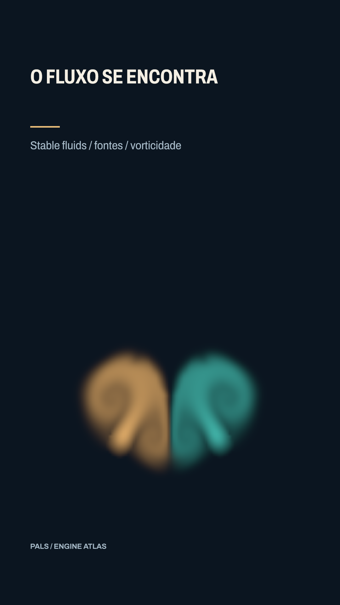

# O fluxo se encontra



[Clipe de 3.5 s](clip.mp4)

Duas fontes de dye e velocidade formam correntes que se encontram numa simulação 2D real. Vitrine revisada: Archivo, subtítulo36 e assunto próprio. Vitrine revisada: Archivo, subtítulo36 e assunto próprio.


**Parâmetros:** Resolution 112, vorticity 4, buoyancy 80, iterations 32; duas fontes com cores distintas e velocityY -230.

**Custo medido:** 32.1 fps medidos na RTX 6000 Ada; 2.65 s de encode, sem espera na fila. Still: 1.384 s no servidor 2, medidos em still-metrics.json. Cada clipe tem 84 quadros, 1080×1920, 24 fps, quality final. `encode.json` guarda adaptador, warnings, estágios e FPS; `render.log` guarda o still.

**Limites e armadilhas:** Fluido 2D estilizado, sem solver CFD validado para um experimento científico. Resolução, passos e pressão dominam CPU; cores literais.

**Como usar num Short:** Convecção ilustrativa; mistura entre duas correntes; explicar compressão visualmente sem fingir cálculo científico.

```bash
# Dentro de /home/pals/videos/ENGINE-ATLAS, still no servidor 2:
SR_AGENT=cx-engine ~/videos/tools/sr-remote ~/.local/share/scene-render/bin/scene-render-premium render 14-fluid/scene.xml --time 3.25 -o 14-fluid/still.png --strict --quality final < /dev/null
# Clipe (quando há movimento), uma chamada própria à fila:
SR_AGENT=cx-engine SR_GPU_SHORT=1 ~/.local/share/scene-render/bin/sr-gpu ~/.local/share/scene-render/bin/scene-render-premium encode 14-fluid/scene.xml -o 14-fluid/clip.mp4 --hw nvenc --parallel 1 --strict --no-upload --quality final --json < /dev/null
```

Mantenha a pasta `../assets` ao copiar a cena. Os assets procedurais foram criados nesta sessão; o DEM sintético foi copiado da fixture de teste do motor e a fonte Archivo acompanha a licença OFL em assets/OFL-archivo.txt. A fonte DejaVu está preservada apenas no histórico técnico, com assets/FONT-LICENSE.txt. Este exemplo é uma ferramenta de direção de arte, sem narração e sem aprovação para publicação. A inspeção de stills e a amostragem do arquivo codificado não substituem avaliação do movimento em playback.
