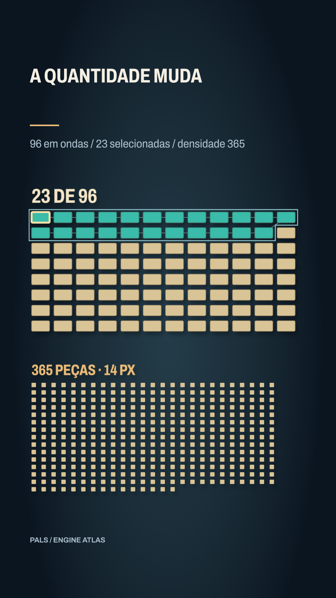

# A quantidade muda



[Clipe de 3.5 s](clip.mp4)

96 peças chegam em oito ondas de12, e o número sobe por camadas com janelas start/end no mesmo instante. Ao final,23 peças mudam de cor. Outra grade mostra365 peças reais de14px. Sem cartão: as peças e números ocupam o campo. Vitrine revisada: Archivo, subtítulo36 e assunto próprio. Vitrine revisada: Archivo, subtítulo36 e assunto próprio.


**Parâmetros:** 12×8=96; timeStep .2, contador discreto12→96;23 destacados. Densidade25×14+15=365,14px. Conector1.5, grupo3, peça6. Archivo caps700/wdth75; câmera z-1500→-1407.

**Custo medido:** 49.1 fps medidos na RTX 6000 Ada; 1.75 s de encode, sem espera na fila. Still: 0.937 s no servidor 2, medidos em still-metrics.json. Cada clipe tem 84 quadros, 1080×1920, 24 fps, quality final. `encode.json` guarda adaptador, warnings, estágios e FPS; `render.log` guarda o still.

**Limites e armadilhas:** Contagens de demonstração, sem dado factual. Sobreposições recolorem peças existentes. A segunda grade é intencionalmente uma textura na escala de telefone; o número e a cor carregam leitura. threeD nos shapes/layers, não apenas no grupo.

**Como usar num Short:** Mostrar N casos de verdade; selecionar um item sem perder a população; aproximar do detalhe e voltar à totalidade mantendo o mesmo objeto.

```bash
# Dentro de /home/pals/videos/ENGINE-ATLAS, still no servidor 2:
SR_AGENT=cx-engine ~/videos/tools/sr-remote ~/.local/share/scene-render/bin/scene-render-premium render 26-rich-2d-count/scene.xml --time 3 -o 26-rich-2d-count/still.png --strict --quality final < /dev/null
# Clipe (quando há movimento), uma chamada própria à fila:
SR_AGENT=cx-engine SR_GPU_SHORT=1 ~/.local/share/scene-render/bin/sr-gpu ~/.local/share/scene-render/bin/scene-render-premium encode 26-rich-2d-count/scene.xml -o 26-rich-2d-count/clip.mp4 --hw nvenc --parallel 1 --strict --no-upload --quality final --json < /dev/null
```

Mantenha a pasta `../assets` ao copiar a cena. Os assets procedurais foram criados nesta sessão; o DEM sintético foi copiado da fixture de teste do motor e a fonte Archivo acompanha a licença OFL em assets/OFL-archivo.txt. A fonte DejaVu está preservada apenas no histórico técnico, com assets/FONT-LICENSE.txt. Este exemplo é uma ferramenta de direção de arte, sem narração e sem aprovação para publicação. A inspeção de stills e a amostragem do arquivo codificado não substituem avaliação do movimento em playback.
