# Atlas visual do rs-scene-render

Exemplos de direção de arte por `cx-engine`, tarefa `engine-atlas-001`. Build `scene-render-premium-f4b4b95bf192`, SHA256 `f4b4b95bf192bedf12af9f3897c7aadb8a8be887a8d380aafc6010aa25f35679`.

Cada pasta traz cena XML, still de vitrine em **1080×1920**, miniatura, parâmetros, limites e usos em Shorts. Recursos de movimento incluem um clipe de **3.5 s / 24 fps / 84 quadros**. Abra o still completo para julgar detalhes; as miniaturas servem à navegação.

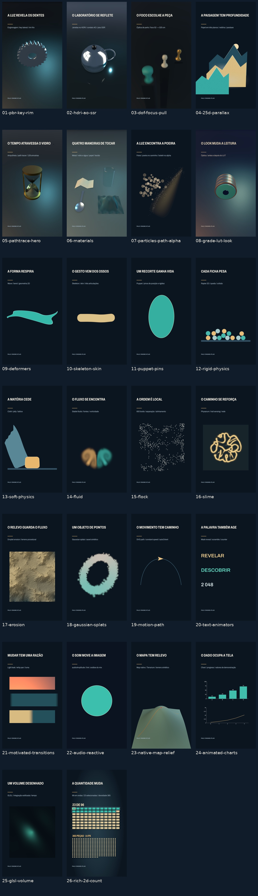

O atlas demonstra recursos, não determina o look dos filmes. Escolha um avanço que explique melhor a ideia e compare com `../shorts/REFERENCE-LOOK/`; o uso de 3D ou mais efeitos não garante qualidade. Fontes embarcadas, assets procedurais originais e uma fixture DEM sintética do motor, sem downloads pagos. Não contém destinos de upload.

| Miniatura | Recurso | Cena / clipe |
|---|---|---|
| 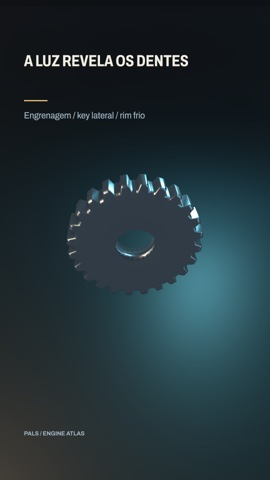 | [A luz revela os dentes](01-pbr-key-rim/README.md) | [XML](01-pbr-key-rim/scene.xml) · [clipe](01-pbr-key-rim/clip.mp4) |
| 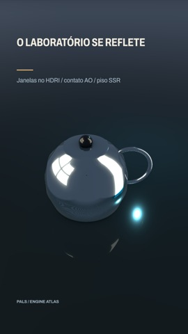 | [O laboratório se reflete](02-hdri-ao-ssr/README.md) | [XML](02-hdri-ao-ssr/scene.xml) · [clipe](02-hdri-ao-ssr/clip.mp4) |
| 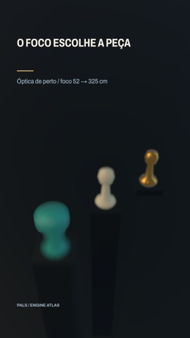 | [O foco escolhe a peça](03-dof-focus-pull/README.md) | [XML](03-dof-focus-pull/scene.xml) · [clipe](03-dof-focus-pull/clip.mp4) |
| 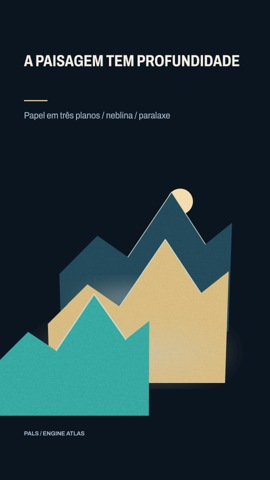 | [A paisagem tem profundidade](04-25d-parallax/README.md) | [XML](04-25d-parallax/scene.xml) · [clipe](04-25d-parallax/clip.mp4) |
| 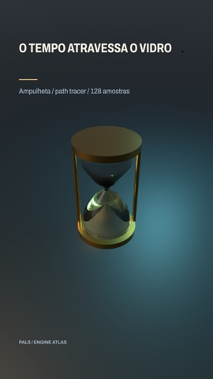 | [O tempo atravessa o vidro](05-pathtrace-hero/README.md) | [XML](05-pathtrace-hero/scene.xml) · still |
| 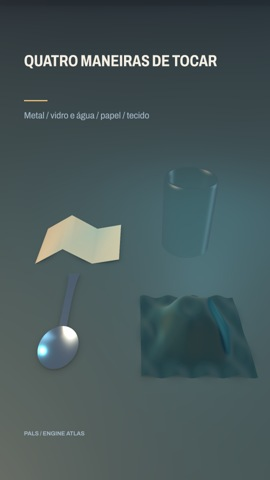 | [Quatro maneiras de tocar](06-materials/README.md) | [XML](06-materials/scene.xml) · [clipe](06-materials/clip.mp4) |
| 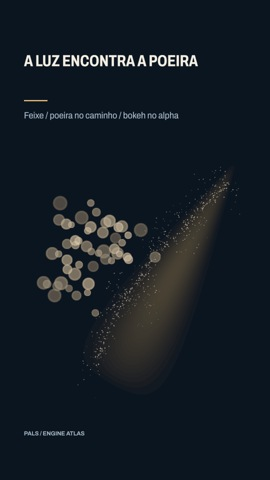 | [A luz encontra a poeira](07-particles-path-alpha/README.md) | [XML](07-particles-path-alpha/scene.xml) · [clipe](07-particles-path-alpha/clip.mp4) |
| 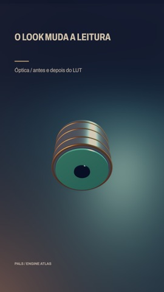 | [O look muda a leitura](08-grade-lut-look/README.md) | [XML](08-grade-lut-look/scene.xml) · [clipe](08-grade-lut-look/clip.mp4) |
| 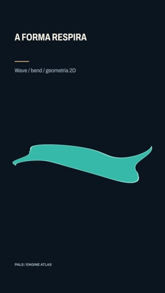 | [A forma respira](09-deformers/README.md) | [XML](09-deformers/scene.xml) · [clipe](09-deformers/clip.mp4) |
| 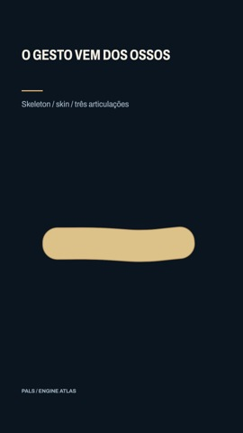 | [O gesto vem dos ossos](10-skeleton-skin/README.md) | [XML](10-skeleton-skin/scene.xml) · [clipe](10-skeleton-skin/clip.mp4) |
| 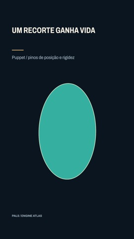 | [Um recorte ganha vida](11-puppet-pins/README.md) | [XML](11-puppet-pins/scene.xml) · [clipe](11-puppet-pins/clip.mp4) |
| 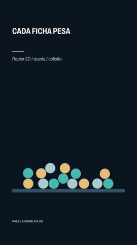 | [Cada ficha pesa](12-rigid-physics/README.md) | [XML](12-rigid-physics/scene.xml) · [clipe](12-rigid-physics/clip.mp4) |
| 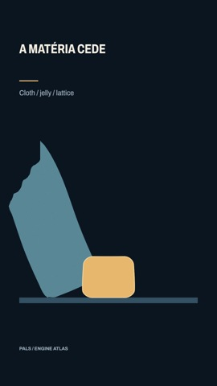 | [A matéria cede](13-soft-physics/README.md) | [XML](13-soft-physics/scene.xml) · [clipe](13-soft-physics/clip.mp4) |
| 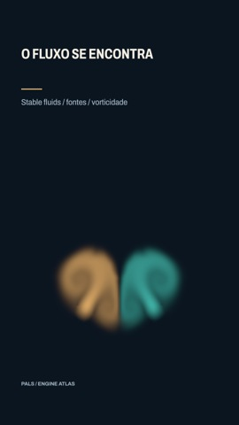 | [O fluxo se encontra](14-fluid/README.md) | [XML](14-fluid/scene.xml) · [clipe](14-fluid/clip.mp4) |
| 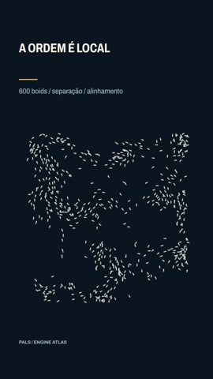 | [A ordem é local](15-flock/README.md) | [XML](15-flock/scene.xml) · [clipe](15-flock/clip.mp4) |
| 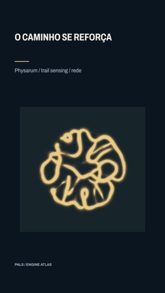 | [O caminho se reforça](16-slime/README.md) | [XML](16-slime/scene.xml) · [clipe](16-slime/clip.mp4) |
| 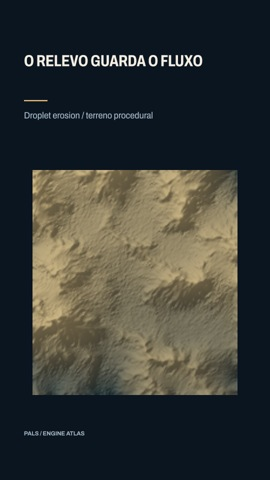 | [O relevo guarda o fluxo](17-erosion/README.md) | [XML](17-erosion/scene.xml) · [clipe](17-erosion/clip.mp4) |
| 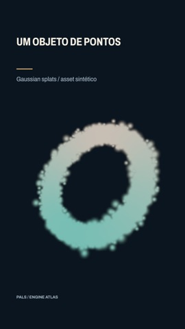 | [Um objeto de pontos](18-gaussian-splats/README.md) | [XML](18-gaussian-splats/scene.xml) · [clipe](18-gaussian-splats/clip.mp4) |
| 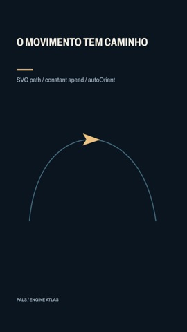 | [O movimento tem caminho](19-motion-path/README.md) | [XML](19-motion-path/scene.xml) · [clipe](19-motion-path/clip.mp4) |
| 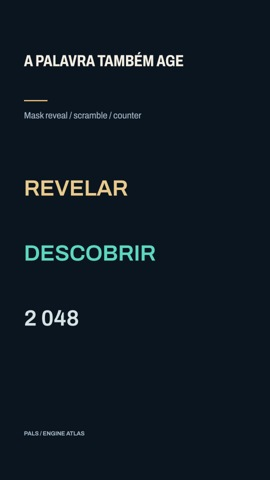 | [A palavra também age](20-text-animators/README.md) | [XML](20-text-animators/scene.xml) · [clipe](20-text-animators/clip.mp4) |
| 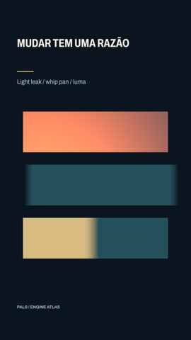 | [Mudar tem uma razão](21-motivated-transitions/README.md) | [XML](21-motivated-transitions/scene.xml) · [clipe](21-motivated-transitions/clip.mp4) |
| 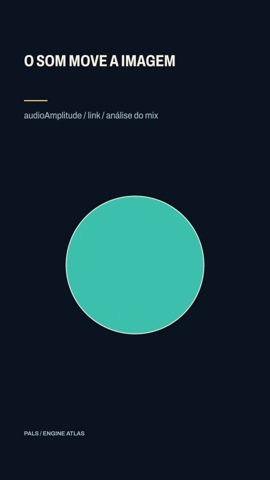 | [O som move a imagem](22-audio-reactive/README.md) | [XML](22-audio-reactive/scene.xml) · [clipe](22-audio-reactive/clip.mp4) |
| 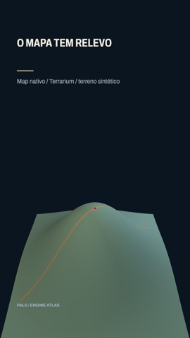 | [O mapa tem relevo](23-native-map-relief/README.md) | [XML](23-native-map-relief/scene.xml) · [clipe](23-native-map-relief/clip.mp4) |
| 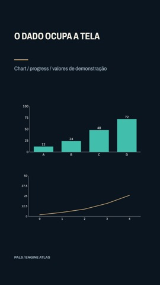 | [O dado ocupa a tela](24-animated-charts/README.md) | [XML](24-animated-charts/scene.xml) · [clipe](24-animated-charts/clip.mp4) |
| 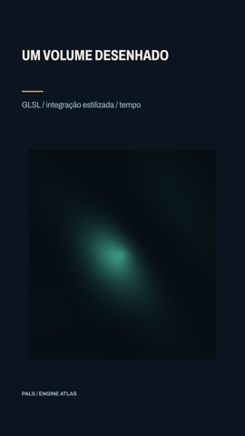 | [Um volume desenhado](25-glsl-volume/README.md) | [XML](25-glsl-volume/scene.xml) · [clipe](25-glsl-volume/clip.mp4) |
| 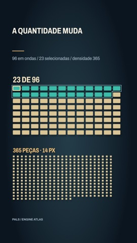 | [A quantidade muda](26-rich-2d-count/README.md) | [XML](26-rich-2d-count/scene.xml) · [clipe](26-rich-2d-count/clip.mp4) |

Verificação: `work/video-checks.json` registra contagem decodificada, dimensões e resultado strict; `SHA256SUMS` identifica esta entrega. Stills foram renderizados no servidor 2; clipes na RTX do servidor 1, um job por vez via sr-gpu, com a taxa confirmada na conclusão de cada encode curto (todos inferiores a um minuto de render). Custos incluem inicialização e variam por cena/host.

Limitações: inspeção visual de stills e amostras codificadas; não ouvi nem assisti os clipes em movimento. A arte deve julgar cadência, foco e composição em playback antes de integrar. Não há scorecard de publicação para estas demonstrações. Pontos que exigem cuidado estão em [ISSUES.md](ISSUES.md).

Diagnóstico de contato rasante: [A/B completo e mínimo](work/contact-shadow-repro/COMPARISON.jpg) · [regiões medidas](work/contact-shadow-repro/metrics.json). `contactShadows=false` na luz afetada preserva as sombras de shadow map; não compense elevando exposição.

Contagem: [ondas12→96,23 selecionadas,365 peças reais](26-rich-2d-count/count-check.json), vitrine da rotaA aprovada pela arte em REVIEW26-r3. Áudio: [pulso no arquivo codificado](work/audio-count-checks.json). O exemplo 22 usa um still extraído do encode para preservar a análise do áudio; o render isolado não a prepara.

Apêndice de desenvolvimento: [27 — Quebras sob controle](27-caption-source-breaks/README.md), evidencia `lineBreaks="source"` em código-fonte testado. Usa frames de bibliotecas em Cargo test; não pertence aos 26 recursos do pin vigente e exige futuro build/rollout antes de uso em filmes.
