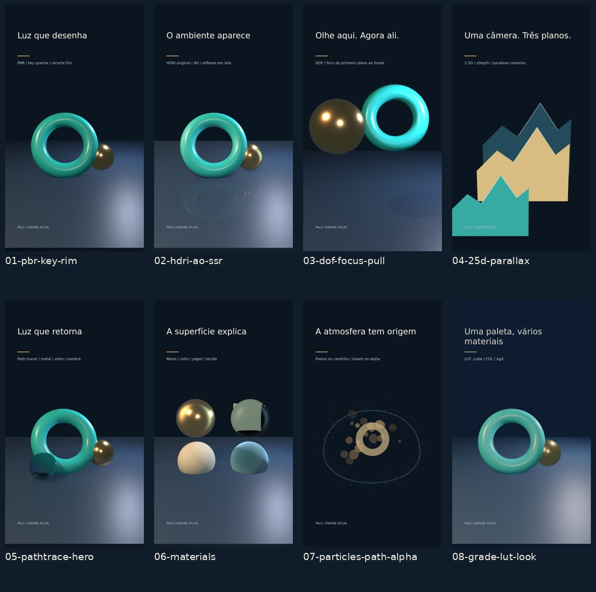

# Atlas visual do rs-scene-render

Exemplos de direção de arte por `cx-engine`, tarefa `engine-atlas-001`. Build `scene-render-premium-f4b4b95bf192`, SHA256 `f4b4b95bf192bedf12af9f3897c7aadb8a8be887a8d380aafc6010aa25f35679`.

Cada pasta traz cena XML, still de vitrine em **1080×1920**, miniatura, parâmetros, limites e usos em Shorts. Recursos de movimento incluem um clipe de **3.5 s / 24 fps / 84 quadros**. Abra o still completo para julgar detalhes; as miniaturas servem à navegação.

O atlas demonstra recursos, não determina o look dos filmes. Escolha um avanço que explique melhor a ideia e compare com `../shorts/REFERENCE-LOOK/`; o uso de 3D ou mais efeitos não garante qualidade. Fontes embarcadas e assets originais, sem downloads pagos. Não contém destinos de upload.

| Miniatura | Recurso | Cena / clipe |
|---|---|---|
|  | [Luz que desenha](01-pbr-key-rim/README.md) | [XML](01-pbr-key-rim/scene.xml) · [clipe](01-pbr-key-rim/clip.mp4) |
|  | [O ambiente aparece](02-hdri-ao-ssr/README.md) | [XML](02-hdri-ao-ssr/scene.xml) · [clipe](02-hdri-ao-ssr/clip.mp4) |
|  | [Olhe aqui. Agora ali.](03-dof-focus-pull/README.md) | [XML](03-dof-focus-pull/scene.xml) · [clipe](03-dof-focus-pull/clip.mp4) |
|  | [Uma câmera. Três planos.](04-25d-parallax/README.md) | [XML](04-25d-parallax/scene.xml) · [clipe](04-25d-parallax/clip.mp4) |
|  | [Luz que retorna](05-pathtrace-hero/README.md) | [XML](05-pathtrace-hero/scene.xml) · still |
|  | [A superfície explica](06-materials/README.md) | [XML](06-materials/scene.xml) · [clipe](06-materials/clip.mp4) |
|  | [A atmosfera tem origem](07-particles-path-alpha/README.md) | [XML](07-particles-path-alpha/scene.xml) · [clipe](07-particles-path-alpha/clip.mp4) |
|  | [Uma paleta, vários materiais](08-grade-lut-look/README.md) | [XML](08-grade-lut-look/scene.xml) · [clipe](08-grade-lut-look/clip.mp4) |

Verificação: `work/video-checks.json` registra contagem decodificada, dimensões e resultado strict; `SHA256SUMS` identifica esta entrega. Stills foram renderizados no servidor 2; clipes na RTX do servidor 1, um job por vez via sr-gpu, com a taxa confirmada na conclusão de cada encode curto (todos inferiores a um minuto de render). Custos incluem inicialização e variam por cena/host.

Limitações: inspeção visual de stills e amostras codificadas; não ouvi nem assisti os clipes em movimento. A arte deve julgar cadência, foco e composição em playback antes de integrar. Não há scorecard de publicação para estas demonstrações. Pontos que exigem cuidado estão em [ISSUES.md](ISSUES.md).
