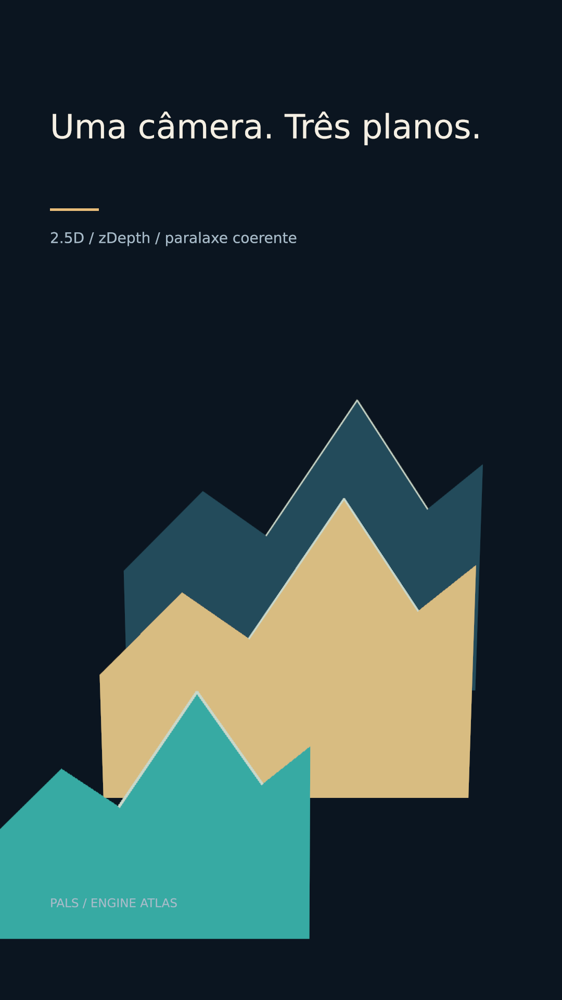

# Uma câmera. Três planos.



[Clipe de 3.5 s](clip.mp4)

Três recortes de montanha separados em z respondem a um único deslocamento de câmera.

**Parâmetros:** zDepth 700 / 0 / -450; câmera x 450 → 630; FOV 42; âncoras no centro.

**Custo medido:** 57.5 fps medidos na RTX 6000 Ada; 1.50 s de encode, sem espera na fila. Cada clipe tem 84 quadros, 1080×1920, 24 fps, quality final. `encode.json` guarda adaptador, warnings, estágios e FPS; `render.log` guarda o still.

**Limites e armadilhas:** Ordenação só entre irmãos threeD consecutivos. Placas não recebem DOF. Use imagem com alpha para recortes orgânicos.

**Como usar num Short:** Arquivo histórico em três recortes; camadas de um relevo; aproximação através de um instrumento.

```bash
# Dentro de /home/pals/videos/ENGINE-ATLAS, still no servidor 2:
SR_AGENT=cx-engine ~/videos/tools/sr-remote ~/.local/share/scene-render/bin/scene-render-premium render 04-25d-parallax/scene.xml --time 1.75 -o 04-25d-parallax/still.png --strict --quality final < /dev/null
# Clipe (quando há movimento), uma chamada própria à fila:
SR_AGENT=cx-engine SR_GPU_SHORT=1 ~/.local/share/scene-render/bin/sr-gpu ~/.local/share/scene-render/bin/scene-render-premium encode 04-25d-parallax/scene.xml -o 04-25d-parallax/clip.mp4 --hw nvenc --parallel 1 --strict --no-upload --quality final --json < /dev/null
```

Mantenha a pasta `../assets` ao copiar a cena. Os assets procedurais foram criados nesta sessão; o DEM sintético foi copiado da fixture de teste do motor e a fonte DejaVu acompanha seu aviso em assets/FONT-LICENSE.txt. Este exemplo é uma ferramenta de direção de arte, sem narração e sem aprovação para publicação. A inspeção de stills e a amostragem do arquivo codificado não substituem avaliação do movimento em playback.
