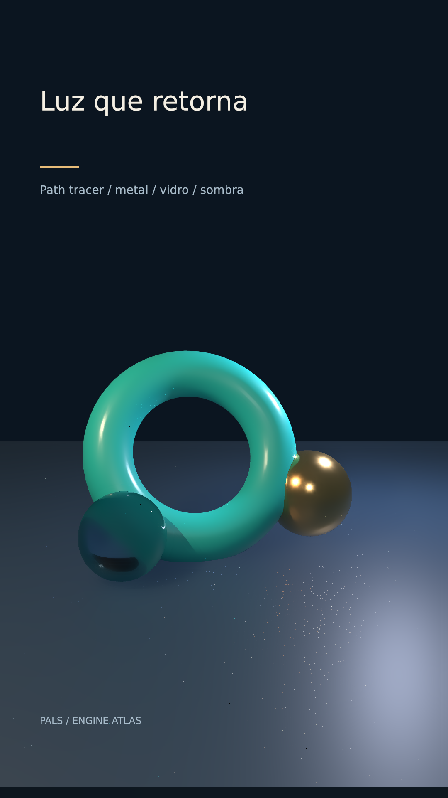

# Luz que retorna



Quadro-herói estático; sem clipe necessário.

Quadro de capa com reflexões e iluminação indireta determinísticas.

**Parâmetros:** 64 amostras, 5 bounces e denoise para ensaio; 128–256 amostras para capa, medir antes.

**Custo medido:** Somente still; 51.357 s medidos no servidor 2 (registro da primeira rodada em ISSUES.md). Cada clipe tem 84 quadros, 1080×1920, 24 fps, quality final. `encode.json` guarda adaptador, warnings, estágios e FPS; `render.log` guarda o still.

**Limites e armadilhas:** Vidro é opaco aos raios de sombra: sem cáusticas. Denoiser pode suavizar detalhe. Custo multiplicado por amostras/pixels; reserve para hero still.

**Como usar num Short:** Capa de uma peça ou material; comparação de acabamento; revelar uma amostra como objeto de museu.

```bash
# Dentro de /home/pals/videos/ENGINE-ATLAS, still no servidor 2:
SR_AGENT=cx-engine ~/videos/tools/sr-remote ~/.local/share/scene-render/bin/scene-render-premium render 05-pathtrace-hero/scene.xml --time 1.75 -o 05-pathtrace-hero/still.png --strict --quality final < /dev/null
# Clipe (quando há movimento), uma chamada própria à fila:
SR_AGENT=cx-engine SR_GPU_SHORT=1 ~/.local/share/scene-render/bin/sr-gpu ~/.local/share/scene-render/bin/scene-render-premium encode 05-pathtrace-hero/scene.xml -o 05-pathtrace-hero/clip.mp4 --hw nvenc --parallel 1 --strict --no-upload --quality final --json < /dev/null
```

Mantenha a pasta `../assets` ao copiar a cena. Os assets procedurais foram criados nesta sessão; o DEM sintético foi copiado da fixture de teste do motor e a fonte DejaVu acompanha seu aviso em assets/FONT-LICENSE.txt. Este exemplo é uma ferramenta de direção de arte, sem narração e sem aprovação para publicação. A inspeção de stills e a amostragem do arquivo codificado não substituem avaliação do movimento em playback.
