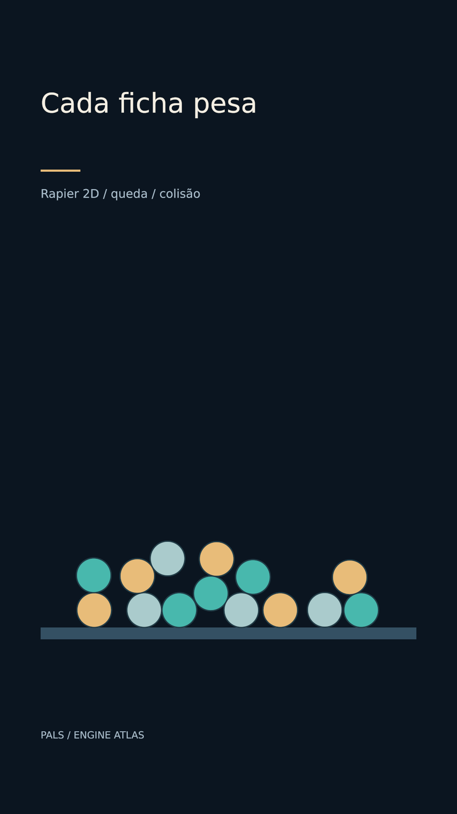

# Cada ficha pesa



[Clipe de 3.5 s](clip.mp4)

Quatorze fichas caem e se apoiam num chão estático em uma execução real do motor.

**Parâmetros:** 14 corpos circle de 82 px; gravity padrão, PPM 100, restitution .26, friction .6; --parallel 1.

**Custo medido:** 59.5 fps medidos na RTX 6000 Ada; 1.45 s de encode, sem espera na fila. Still: 0.684 s no servidor 2, medidos em still-metrics.json. Cada clipe tem 84 quadros, 1080×1920, 24 fps, quality final. `encode.json` guarda adaptador, warnings, estágios e FPS; `render.log` guarda o still.

**Limites e armadilhas:** Não prometer uma disposição final específica sem verificar a simulação. Physics cache pode fixar o resultado; renderizações seguem serial nesta produção.

**Como usar num Short:** Contagem que se acumula; distribuição de probabilidades como fichas; comparar massa ou atrito.

```bash
# Dentro de /home/pals/videos/ENGINE-ATLAS, still no servidor 2:
SR_AGENT=cx-engine ~/videos/tools/sr-remote ~/.local/share/scene-render/bin/scene-render-premium render 12-rigid-physics/scene.xml --time 1.75 -o 12-rigid-physics/still.png --strict --quality final < /dev/null
# Clipe (quando há movimento), uma chamada própria à fila:
SR_AGENT=cx-engine SR_GPU_SHORT=1 ~/.local/share/scene-render/bin/sr-gpu ~/.local/share/scene-render/bin/scene-render-premium encode 12-rigid-physics/scene.xml -o 12-rigid-physics/clip.mp4 --hw nvenc --parallel 1 --strict --no-upload --quality final --json < /dev/null
```

Mantenha a pasta `../assets` ao copiar a cena. Os assets procedurais foram criados nesta sessão; o DEM sintético foi copiado da fixture de teste do motor e a fonte DejaVu acompanha seu aviso em assets/FONT-LICENSE.txt. Este exemplo é uma ferramenta de direção de arte, sem narração e sem aprovação para publicação. A inspeção de stills e a amostragem do arquivo codificado não substituem avaliação do movimento em playback.
