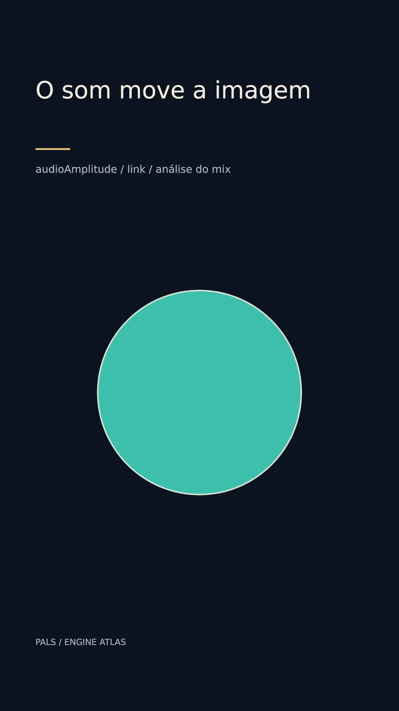

# O som move a imagem



[Clipe de 3.5 s](clip.mp4)

O círculo lê o envelope low da trilha realmente misturada na entrega. Pulso original gerado para a demonstração.

**Parâmetros:** link audio:drum:low, scale .5, offset .75; som com cinco ataques a .25 / 1 / 1.75 / 2.5 / 3.1 s.

**Custo medido:** 61.3 fps medidos na RTX 6000 Ada; 1.49 s de encode, sem espera na fila. Still: 0.661 s no servidor 2, medidos em still-metrics.json. O still é um quadro decodificado do clipe com análise de áudio. Cada clipe tem 84 quadros, 1080×1920, 24 fps, quality final. `encode.json` guarda adaptador, warnings, estágios e FPS; `render.log` guarda o still.

**Limites e armadilhas:** render isolado não prepara análise de áudio. O still deste recurso deve vir do encode. Não há avaliação de escuta nesta sessão; som da vitrine precisa playback.

**Como usar num Short:** Pulso no componente que faz o som; espectro ligado à onda falada; reagir a batidas sem marcar cada key à mão.

```bash
# Dentro de /home/pals/videos/ENGINE-ATLAS, still no servidor 2:
SR_AGENT=cx-engine ~/videos/tools/sr-remote ffmpeg -nostdin -v error -threads 2 -ss 1.833333 -i 22-audio-reactive/clip.mp4 -frames:v 1 -y 22-audio-reactive/still.png < /dev/null
# Clipe (quando há movimento), uma chamada própria à fila:
SR_AGENT=cx-engine SR_GPU_SHORT=1 ~/.local/share/scene-render/bin/sr-gpu ~/.local/share/scene-render/bin/scene-render-premium encode 22-audio-reactive/scene.xml -o 22-audio-reactive/clip.mp4 --hw nvenc --parallel 1 --strict --no-upload --quality final --json < /dev/null
```

Mantenha a pasta `../assets` ao copiar a cena. Os assets procedurais foram criados nesta sessão; o DEM sintético foi copiado da fixture de teste do motor e a fonte DejaVu acompanha seu aviso em assets/FONT-LICENSE.txt. Este exemplo é uma ferramenta de direção de arte, sem narração e sem aprovação para publicação. A inspeção de stills e a amostragem do arquivo codificado não substituem avaliação do movimento em playback.
