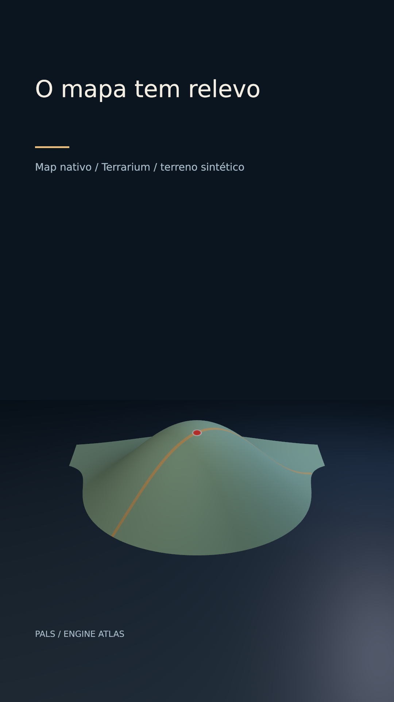

# O mapa tem relevo



[Clipe de 3.5 s](clip.mp4)

Um map asset é drapeado num mesh, elevado por tiles Terrarium e iluminado no renderer 3D. O exagero vertical de 4× torna a encosta legível nesta demonstração.

**Parâmetros:** Web Mercator zoom12, terrain DEM, resolution96, texture768, exaggeration4; tilt -65°; câmera z -1100.

**Custo medido:** 53.9 fps medidos na RTX 6000 Ada; 1.60 s de encode, sem espera na fila. Still: 1.122 s no servidor 2, medidos em still-metrics.json. Cada clipe tem 84 quadros, 1080×1920, 24 fps, quality final. `encode.json` guarda adaptador, warnings, estágios e FPS; `render.log` guarda o still.

**Limites e armadilhas:** Este exemplo é uma ilha e elevação sintéticas, sem localização factual. Terrain precisa Web Mercator. Dados reais exigem licença/crédito e exagero declarado; globe ainda não tem terrain. Contact shadows desligadas no plano; shadow maps preservados.

**Como usar num Short:** Mostrar um trajeto sobre a encosta; comparar relevo e caminho; aproximar da região que altera uma decisão.

```bash
# Dentro de /home/pals/videos/ENGINE-ATLAS, still no servidor 2:
SR_AGENT=cx-engine ~/videos/tools/sr-remote ~/.local/share/scene-render/bin/scene-render-premium render 23-native-map-relief/scene.xml --time 1.75 -o 23-native-map-relief/still.png --strict --quality final < /dev/null
# Clipe (quando há movimento), uma chamada própria à fila:
SR_AGENT=cx-engine SR_GPU_SHORT=1 ~/.local/share/scene-render/bin/sr-gpu ~/.local/share/scene-render/bin/scene-render-premium encode 23-native-map-relief/scene.xml -o 23-native-map-relief/clip.mp4 --hw nvenc --parallel 1 --strict --no-upload --quality final --json < /dev/null
```

Mantenha a pasta `../assets` ao copiar a cena. Os assets procedurais foram criados nesta sessão; o DEM sintético foi copiado da fixture de teste do motor e a fonte DejaVu acompanha seu aviso em assets/FONT-LICENSE.txt. Este exemplo é uma ferramenta de direção de arte, sem narração e sem aprovação para publicação. A inspeção de stills e a amostragem do arquivo codificado não substituem avaliação do movimento em playback.
