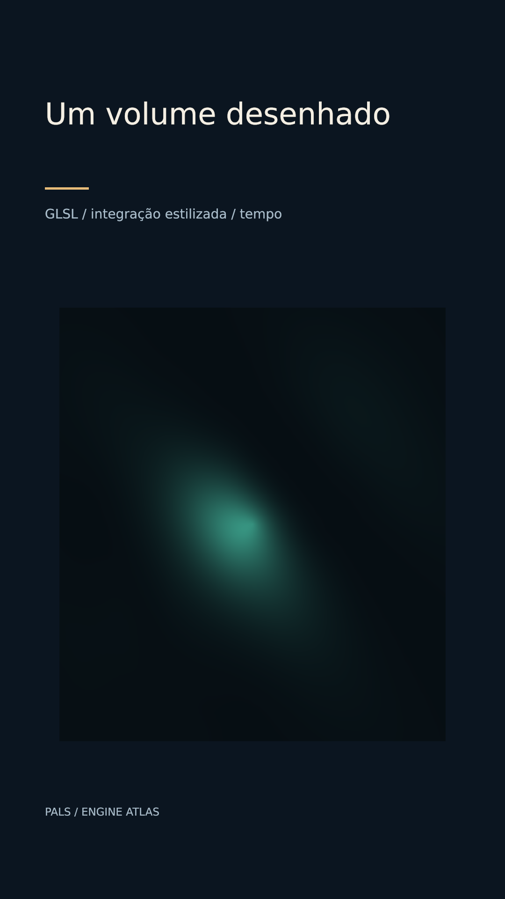

# Um volume desenhado



[Clipe de 3.5 s](clip.mp4)

Shader integra 24 camadas de densidade para uma aparência de volume animado, num único quad.

**Parâmetros:** 24 passos; iTime no sin/cos; gradação ciano sutil; superfície820×920.

**Custo medido:** 57.6 fps medidos na RTX 6000 Ada; 1.49 s de encode, sem espera na fila. Still: 0.886 s no servidor 2, medidos em still-metrics.json. Cada clipe tem 84 quadros, 1080×1920, 24 fps, quality final. `encode.json` guarda adaptador, warnings, estágios e FPS; `render.log` guarda o still.

**Limites e armadilhas:** Volume estilizado, sem física de transporte de luz e sem interação com luzes PBR. GLSL inválido pode passar input: sempre exigir --strict.

**Como usar num Short:** Campo invisível mostrado como ilustração; turbulência como fundo localizado; mostrar a zona ativa de um fenômeno.

```bash
# Dentro de /home/pals/videos/ENGINE-ATLAS, still no servidor 2:
SR_AGENT=cx-engine ~/videos/tools/sr-remote ~/.local/share/scene-render/bin/scene-render-premium render 25-glsl-volume/scene.xml --time 1.75 -o 25-glsl-volume/still.png --strict --quality final < /dev/null
# Clipe (quando há movimento), uma chamada própria à fila:
SR_AGENT=cx-engine SR_GPU_SHORT=1 ~/.local/share/scene-render/bin/sr-gpu ~/.local/share/scene-render/bin/scene-render-premium encode 25-glsl-volume/scene.xml -o 25-glsl-volume/clip.mp4 --hw nvenc --parallel 1 --strict --no-upload --quality final --json < /dev/null
```

Mantenha a pasta `../assets` ao copiar a cena. Os assets procedurais foram criados nesta sessão; o DEM sintético foi copiado da fixture de teste do motor e a fonte DejaVu acompanha seu aviso em assets/FONT-LICENSE.txt. Este exemplo é uma ferramenta de direção de arte, sem narração e sem aprovação para publicação. A inspeção de stills e a amostragem do arquivo codificado não substituem avaliação do movimento em playback.
