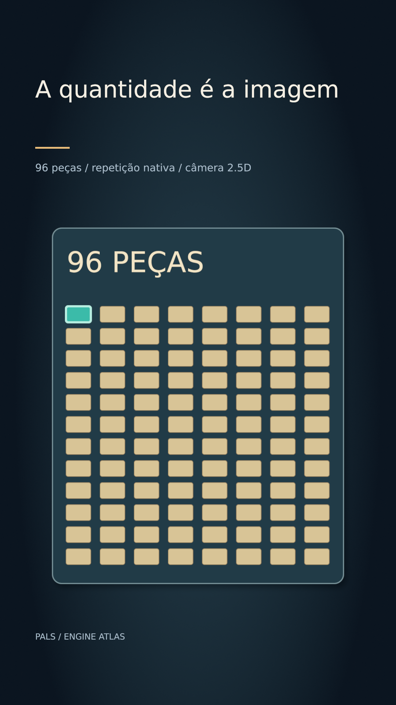

# A quantidade é a imagem



[Clipe de 3.5 s](clip.mp4)

A imagem contém exatamente 12×8=96 peças. Um shapeModifier repeater cria cada fila; repeat cria as 12 filas. A peça escolhida é recolorida por uma cobertura coincidente, sem adicionar uma peça à contagem visível.

**Parâmetros:** 8 copies ×12 rows; traços 1.5 /3 /6 px; luz radial; drop-shadow radius12 offsetY12; câmera real z -1500 → -1407.

**Custo medido:** 58.4 fps medidos na RTX 6000 Ada; 1.48 s de encode, sem espera na fila. Still: 0.897 s no servidor 2, medidos em still-metrics.json. Cada clipe tem 84 quadros, 1080×1920, 24 fps, quality final. `encode.json` guarda adaptador, warnings, estágios e FPS; `render.log` guarda o still.

**Limites e armadilhas:** A contagem é demonstrativa, não dado de uma pesquisa. A cobertura escolhida coincide com a primeira peça. O plano único usa 2.5D apenas para câmera real; nenhum efeito 3D é necessário para enriquecer a informação. Aplique threeD aos shapes/layers, não só ao grupo transparente que os contém.

**Como usar num Short:** Mostrar N casos de verdade; selecionar um item sem perder a população; aproximar do detalhe e voltar à totalidade mantendo o mesmo objeto.

```bash
# Dentro de /home/pals/videos/ENGINE-ATLAS, still no servidor 2:
SR_AGENT=cx-engine ~/videos/tools/sr-remote ~/.local/share/scene-render/bin/scene-render-premium render 26-rich-2d-count/scene.xml --time 1.75 -o 26-rich-2d-count/still.png --strict --quality final < /dev/null
# Clipe (quando há movimento), uma chamada própria à fila:
SR_AGENT=cx-engine SR_GPU_SHORT=1 ~/.local/share/scene-render/bin/sr-gpu ~/.local/share/scene-render/bin/scene-render-premium encode 26-rich-2d-count/scene.xml -o 26-rich-2d-count/clip.mp4 --hw nvenc --parallel 1 --strict --no-upload --quality final --json < /dev/null
```

Mantenha a pasta `../assets` ao copiar a cena. Os assets procedurais foram criados nesta sessão; o DEM sintético foi copiado da fixture de teste do motor e a fonte DejaVu acompanha seu aviso em assets/FONT-LICENSE.txt. Este exemplo é uma ferramenta de direção de arte, sem narração e sem aprovação para publicação. A inspeção de stills e a amostragem do arquivo codificado não substituem avaliação do movimento em playback.
